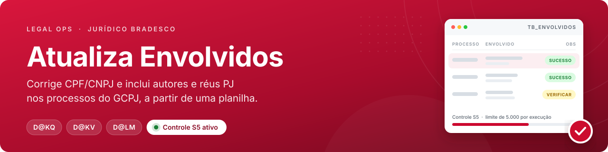
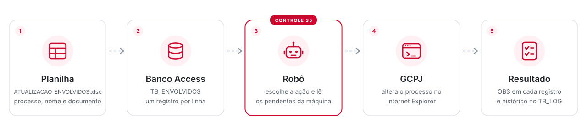
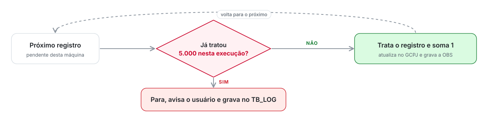

<div align="center">



<br><br>


<br><br>

**[Visão geral](#visão-geral)** · **[Como rodar](#como-rodar)** · **[Recebi uma RO, e agora?](#recebi-uma-ro-e-agora)** · **[Controle S5](#controle-s5)** · **[Visão técnica](#visão-técnica)**

</div>

<br>

## Visão geral

> **Em uma frase:** o robô lê uma planilha de envolvidos e, processo por processo, ajusta o cadastro deles no GCPJ, deixando anotado em cada linha o que aconteceu.

<picture>
  <source media="(prefers-color-scheme: dark)" srcset="docs/readme/fluxo-dark.svg">
  
</picture>

### As três ações

| Botão na tela | Código | O que faz | Processos |
| :--- | :---: | :--- | :---: |
| **Atualizar CPF/CNPJ Envolvido** | `D@KQ` | Acha o envolvido pelo nome dentro do processo e grava o CPF/CNPJ correto. Se o documento não existir na base, corrige no cadastro de pessoa externa | Ativos e encerrados |
| **Inserir Demais Autores** | `D@KV` | Inclui o envolvido como **autor**. Se a pessoa ainda não existir, cadastra no INFRA antes | Ativos |
| **Inserir PJ RÉU** | `D@LM` | Inclui a empresa como **réu**. Se ainda não existir, cadastra no INFRA antes | Ativos |

### Ficha rápida

| Item | Detalhe |
| :--- | :--- |
| **Repositório** | `aajr-cmn-atualizaenvolvidos` |
| **Área dona** | 4040 Dejur / COLDA - Collab Dev's & Analytics |
| **Tipo** | Robô de tela (RPA) em C# Windows Forms, .NET Framework 4.8, compilado em **x86** |
| **Sistemas que altera** | GCPJ (e INFRA, quando precisa cadastrar a pessoa) |
| **Entrada** | Planilha `ATUALIZACAO_ENVOLVIDOS.xlsx`, aba `Planilha1` |
| **Saída** | Coluna `OBS` da `TB_ENVOLVIDOS` + histórico na `TB_LOG` |
| **Base local** | `BD\BD_DADOS.accdb`, ao lado do executável |
| **Horário** | Pausa sozinho das **23h às 6h** |
| **Controle S5** | Até **5.000 registros por execução**, por máquina |

<br>

## Como rodar

**Antes de começar, a máquina precisa ter:**

- Windows com **Internet Explorer** e acesso ao GCPJ
- **Microsoft Access Database Engine 32 bits** (o projeto é x86, então o ACE OLEDB 12.0 tem que ser 32 bits)
- **Excel**, só para o link *Exportar para Excel*

**Passo a passo:**

1. Abra `ComplementaCadastro.sln` no Visual Studio e rode (ou use o executável já gerado).
2. Salve a planilha como `ATUALIZACAO_ENVOLVIDOS.xlsx` no diretório do sistema, com as colunas abaixo, e clique em **Importar planilha**.
3. Se for dividir o trabalho, digite a **quantidade** de máquinas no campo *Máquina* e clique em **Distribuir Máquinas**.
4. Em cada máquina, digite o **número dela** no campo *Máquina* (1, 2, 3...).
5. Clique em **Conectar GCPJ** e faça login no Internet Explorer que abrir.
6. Clique na ação desejada e confirme. A grade de baixo mostra o andamento em tempo real.

| Coluna da planilha | Exemplo | Regra |
| :--- | :--- | :--- |
| `BRADESCO` | `123456789` | Número do processo no GCPJ |
| `ENVOLVIDO` | `MARIA DA SILVA` | Nome **igual** ao que está no GCPJ (com ou sem acento) |
| `CPF_CNPJ` | `123456789` | Só a raiz: 9 dígitos para CPF, 8 para CNPJ |
| `FILIAL` | `0` ou `1` | `0` = pessoa física. Para empresa, o número da filial |
| `DIGITO` | `09` | Os 2 dígitos verificadores |

> [!TIP]
> O campo **Máquina** tem dois usos: no *Distribuir Máquinas* ele é a **quantidade** de máquinas; nas ações ele é o **número desta máquina**. Cada máquina só trata as linhas com o número dela na coluna `MAQUINA`.

<br>

## Recebi uma RO, e agora?

Três passos resolvem a maioria dos casos:

1. **Veja a coluna OBS** da linha reclamada (dá para clicar em *Exportar para Excel* e filtrar pelo processo).
2. **Veja a `TB_LOG`** no Access para saber quem rodou, em qual máquina e quando.
3. **Procure a OBS** na tabela abaixo.

| | OBS gravada | O que quer dizer | O que fazer |
| :---: | :--- | :--- | :--- |
| 🟢 | `ATUALIZAÇÃO EFETUADA COM SUCESSO` | Deu certo | Nada |
| 🟢 | `CPF/CNPJ JÁ CADASTRADO PARA O ENVOLVIDO INFORMADO` | Já estava certo no GCPJ | Nada |
| 🟢 | `O ENVOLVIDO JÁ ESTÁ RELACIONADO COMO AUTOR` / `COMO RÉU NESSE PROCESSO` | Já existia no processo | Nada |
| 🟡 | `... PORÉM COM UMA DIVERGÊNCIA NO NOME: (nome)` | Gravou, mas o nome no GCPJ é diferente do da planilha | Conferir se é a mesma pessoa |
| 🟡 | `MAIS DE UM ENVOLVIDO LOCALIZADO COM O DOCUMENTO INFORMADO` | O GCPJ abriu a janela de escolha entre pessoas | Tratar manualmente |
| 🟡 | `DOCUMENTO PERTENCE A OUTRO ENVOLVIDO (...) JÁ RELACIONADO` | O documento já está em outra pessoa do processo | Analisar com a área |
| 🔴 | `NOME DO ENVOLVIDO NÃO LOCALIZADO` / `ERRO AO LOCALIZAR O NOME` | O nome da planilha não bate com nenhum envolvido do processo | Corrigir o nome (espaços, abreviações) e reprocessar |
| 🔴 | `ERRO AO ACESSAR O PROCESSO` / `FALHA AO PESQUISAR O PROCESSO` | O processo não abriu no GCPJ | Conferir o número. D@KV e D@LM só abrem processos **ativos** |
| 🔴 | `DOCUMENTO INVALIDO` / `NAO LOCALIZADO` / `NÃO FOI POSSÍVEL CADASTRAR ENVOLVIDO` | O GCPJ ou o INFRA recusou o documento | Conferir raiz, filial e dígito na planilha |
| 🔴 | `ERRO TELA DO ENVOLVIDO` / `ERRO AO SALVAR` | O GCPJ deu erro ou não saiu da tela depois de salvar | Reprocessar. Se repetir, fazer manual |
| 🔴 | `ERRO AO ATUALIZAR DOCUMENTO` / `ERRO AO INSERIR ENVOLVIDO` / `ERRO AO INSERIR PJ RÉU` | Erro inesperado, quase sempre GCPJ lento ou fora do ar | Reprocessar |

> [!IMPORTANT]
> **Toda linha tratada fica com `ATUALIZADO = TRUE`, até as que deram erro.** Para reprocessar, volte a linha para pendente no Access:
> ```sql
> UPDATE TB_ENVOLVIDOS SET ATUALIZADO = FALSE, OBS = NULL WHERE OBS LIKE 'ERRO*';
> ```

**Problemas antes mesmo de rodar:**

| O que aparece | Causa provável | Solução |
| :--- | :--- | :--- |
| *Erro ao importar o arquivo* | Planilha fora do lugar, com outro nome ou com colunas diferentes | Conferir nome, aba `Planilha1` e colunas. No Access, conferir o vínculo da tabela `ATUALIZACAO_ENVOLVIDOS` em *Dados Externos ➜ Gerenciador de Tabelas Vinculadas* |
| *ATENÇÃO: Conecte ao GCPJ para continuar.* | Não achou uma janela do IE com "GCPJ" no título | Clicar em **Conectar GCPJ** e logar |
| Clico na ação e nada acontece | Não há linha pendente para o número digitado em *Máquina* | Conferir a coluna `MAQUINA` e o campo *Máquina* |
| O provedor *Microsoft.ACE.OLEDB.12.0* não está registrado | Falta o Access Database Engine 32 bits | Instalar a versão **32 bits** |
| O robô "travou" à noite | É a pausa programada das 23h às 6h | Esperar. Ele volta sozinho a partir das 6h |
| Aviso **Processamento Limitado - Controle S5** | Chegou a 5.000 registros nesta execução | Normal. Rodar de novo continua de onde parou |

<br>

## Controle S5

Exigência do normativo **05.1073** para aplicativos com C10 = Sim. Os três códigos (`D@KQ`, `D@KV`, `D@LM`) foram apontados por Riscos Digitais como **Risco Inerente Moderado sem S5** e agora têm o controle.

<picture>
  <source media="(prefers-color-scheme: dark)" srcset="docs/readme/s5-dark.svg">
  
</picture>

Quando o limite é atingido, aparece o aviso **Processamento Limitado - Controle S5**, a grade mostra *"Controle S5: limite de 5.000 registros atingido"* e a `TB_LOG` recebe *"CONTROLE S5 - LIMITE DE OPERACOES ATINGIDO - (ação) - MÁQUINA (n)"*. O que sobrou continua pendente para a próxima execução.

| O que mudar | Arquivo | Onde |
| :--- | :--- | :--- |
| **Valor do limite** | `LimitadorS5.cs` | constante `LIMITE_OPERACOES`, linha 28 |
| Mensagem do aviso | `LimitadorS5.cs` | método `LimiteAtingido` |
| Checagem do D@KQ | `Form1.cs` | `btnAtualizaCPF_Click`, bloco `[S5]` na linha 255 |
| Checagem do D@KV | `Form1.cs` | `btn_InsereEnvolvido_Click`, bloco `[S5]` na linha 532 |
| Checagem do D@LM | `Form1.cs` | `btn_InserePjReu_Click`, bloco `[S5]` na linha 809 |

> [!TIP]
> Para testar sem esperar 5.000 registros: troque `LIMITE_OPERACOES` para `2`, rode com 3 linhas, tire os prints com o relógio do Windows aparecendo e **volte para 5000**. No Visual Studio, **Ctrl+Shift+F** em `[S5]` mostra todos os pontos. As evidências oficiais estão em [`docs/Evidencias_S5_AtualizaEnvolvidos.docx`](docs/Evidencias_S5_AtualizaEnvolvidos.docx).

<br>

## Visão técnica

<details>
<summary><b>Mapa do código</b> &nbsp;·&nbsp; onde fica cada coisa</summary>
<br>

Projeto: `ComplementaCadastro\ATUALIZA_ENVOLVIDOS.csproj`

| Arquivo | Trecho | Linha | Para que serve |
| :--- | :--- | :---: | :--- |
| `Form1.cs` | `gravaLOG` | 16 | Grava uma linha na `TB_LOG` (usuário do Windows, ação, data e hora) |
| | `btn_Importar_Click` | 49 | Roda as procedures `000_LIMPAR_TB_ENVOLVIDOS` e `001_ACRESCIMO_TB_ENVOLVIDOS` |
| | `btnDistribuir_Click` | 102 | Reparte as linhas pendentes entre as máquinas (rodízio 1, 2, 3...) |
| | `IniciaProcessamento` | 203 | Confere se o GCPJ está aberto e se o campo *Máquina* é um número |
| | `btnAtualizaCPF_Click` | 232 | Ação **D@KQ** |
| | `btn_InsereEnvolvido_Click` | 512 | Ação **D@KV** |
| | `btn_InserePjReu_Click` | 789 | Ação **D@LM** |
| | `ObterStringSemAcentosECaracteresEspeciais` | 496 | Tira acentos para comparar nomes |
| `Automacao.cs` | `localizarJanela` / `novaJanela` | 49 / 63 | Acha ou abre o IE do GCPJ |
| | `navegar`, `setaValorNome`, `clicar`, `espera` | 92 a 199 | Comandos básicos de tela |
| | `lerMsgBox` / `mataPossivelMsgBox` | 241 / 314 | Lê e fecha os alertas do GCPJ |
| | `cadastrarPF` / `cadastrarPJ` | 623 / 679 | Cadastro da pessoa no INFRA |
| | `selecionarTabelaEnvolvido` | 747 | Procura o envolvido na tabela do processo pelo nome |
| `Conexao.cs` | `con` | 13 | Caminho do banco: `BD\BD_DADOS.accdb` ao lado do `.exe` |
| `LimitadorS5.cs` | `LIMITE_OPERACOES` | 28 | Controle S5 |

</details>

<details>
<summary><b>Como cada ação funciona por dentro</b> &nbsp;·&nbsp; passo a passo no GCPJ</summary>
<br>

**D@KQ · Atualizar CPF/CNPJ**

1. Abre *Alteração De/Para* (`cadMantemCadProcAlteracaoAction`, estímulo `alteracaoDePara`) e pesquisa o processo.
2. Procura o nome do envolvido na tabela (com e sem acento) e descobre se ele é **autor** ou **réu**.
3. Se o documento já é o mesmo, grava *CPF/CNPJ JÁ CADASTRADO* e segue.
4. Escolhe PF ou PJ pelo campo `FILIAL` e preenche o documento de destino.
5. Se o documento não existe na base, vai em *Pessoa Externa* (`pessoaExternaBradescoAction`), altera o cadastro e salva.
6. Salva e grava a OBS conforme o retorno do GCPJ.

**D@KV · Inserir Demais Autores** e **D@LM · Inserir PJ Réu**

1. Abre a alteração de processos **ativos** (estímulo `alteracaoAtivos`) e pesquisa o processo.
2. Vai na aba do envolvido, informa o documento e clica em buscar.
3. Se a pessoa não existe, abre o cadastro (`openTelasCadastro`) e cadastra no INFRA com `cadastrarPF` ou `cadastrarPJ`.
4. Clica em *Incluir*. Se o GCPJ disser que já está relacionado, grava isso na OBS.
5. Salva. Se a tela não mudar depois do *Salvar*, grava *ERRO AO SALVAR*.

</details>

<details>
<summary><b>Banco de dados</b> &nbsp;·&nbsp; tabelas e procedures do Access</summary>
<br>

| Objeto | Tipo | Conteúdo |
| :--- | :--- | :--- |
| `TB_ENVOLVIDOS` | Tabela | `CNRO_PROCS_BDSCO` (processo), `NOME`, `CPF/CNPJ`, `FILIAL (PJ)`, `DIGITO`, `ATUALIZADO`, `OBS`, `MAQUINA` |
| `TB_LOG` | Tabela | `ID_Usuario`, `Log`, `DataHora` |
| `ATUALIZACAO_ENVOLVIDOS` | Tabela vinculada | Aponta para a planilha `ATUALIZACAO_ENVOLVIDOS.xlsx`, aba `Planilha1` |
| `000_LIMPAR_TB_ENVOLVIDOS` | Procedure | Apaga a importação anterior |
| `001_ACRESCIMO_TB_ENVOLVIDOS` | Procedure | Copia a planilha vinculada para a `TB_ENVOLVIDOS` |

</details>

<details>
<summary><b>Quero mudar X, onde vou?</b></summary>
<br>

| Quero... | Vá em |
| :--- | :--- |
| Mudar o limite do Controle S5 | `LimitadorS5.cs` ➜ `LIMITE_OPERACOES` |
| Mudar as colunas da planilha | Procedure `001_ACRESCIMO_TB_ENVOLVIDOS` no Access |
| Mudar o horário da pausa (23h às 6h) | `Form1.cs` ➜ início do `while (dr.Read())` de cada ação |
| Mudar como o nome é comparado | `ObterStringSemAcentosECaracteresEspeciais` e `Automacao.selecionarTabelaEnvolvido` |
| Mudar o cadastro no INFRA | `Automacao.cs` ➜ `cadastrarPF` / `cadastrarPJ` |
| Mudar o endereço do GCPJ | `Form1.cs` e `Automacao.cs` ➜ procure `intranet85.net.bradesco.com.br/gcpj` |

</details>

<details>
<summary><b>Pontos de atenção</b> &nbsp;·&nbsp; o que já se sabe e ainda não foi mexido</summary>
<br>

- **Inserir Demais Autores, documento recusado no INFRA:** na linha 627 do `Form1.cs` a comparação usa `"CPF / CNPJ INVALIDO"` (com espaços), mas o `cadastrarPF` devolve `"CPF/CNPJ INVALIDO"` (sem espaços). Por isso, nesse caso o robô não marca a falha ali e segue o fluxo. A ação D@LM (linha 905) está certa. A correção é de uma linha.
- **Nome é comparado por texto exato.** Espaço duplo, abreviação ou nome cortado no GCPJ fazem o robô não achar o envolvido.
- **SQL montado por concatenação.** Nome com aspas simples (ex.: `D'AVILA`) pode dar erro ao gravar a OBS.
- **Depende do layout do GCPJ.** Os campos são achados pelo nome no HTML. Se o GCPJ mudar a tela, o robô quebra naquele passo.
- A pasta `obj` está versionada; ela é gerada na compilação e pode ser ignorada.

</details>

<br>

## Histórico

| Data | Autor | Alteração |
| :--- | :--- | :--- |
| 10/2025 | Beatriz Santos | Migração do Bitbucket |
| 07/2026 | Kaylane Machado | `Trim` na seleção do tipo de envolvido |
| 10/2026 | Gabriel Vasconcellos Gomes | Implementação do **Controle S5** (`LimitadorS5.cs`) e novo README |

<br>

<p align="center">
  <picture>
    <source media="(prefers-color-scheme: dark)" srcset="docs/legalops-logo-dark.png">
    
  </picture>
  <br>
  <sub>Legal Operations • Banco Bradesco S.A. • Classificação: Interna</sub>
</p>
